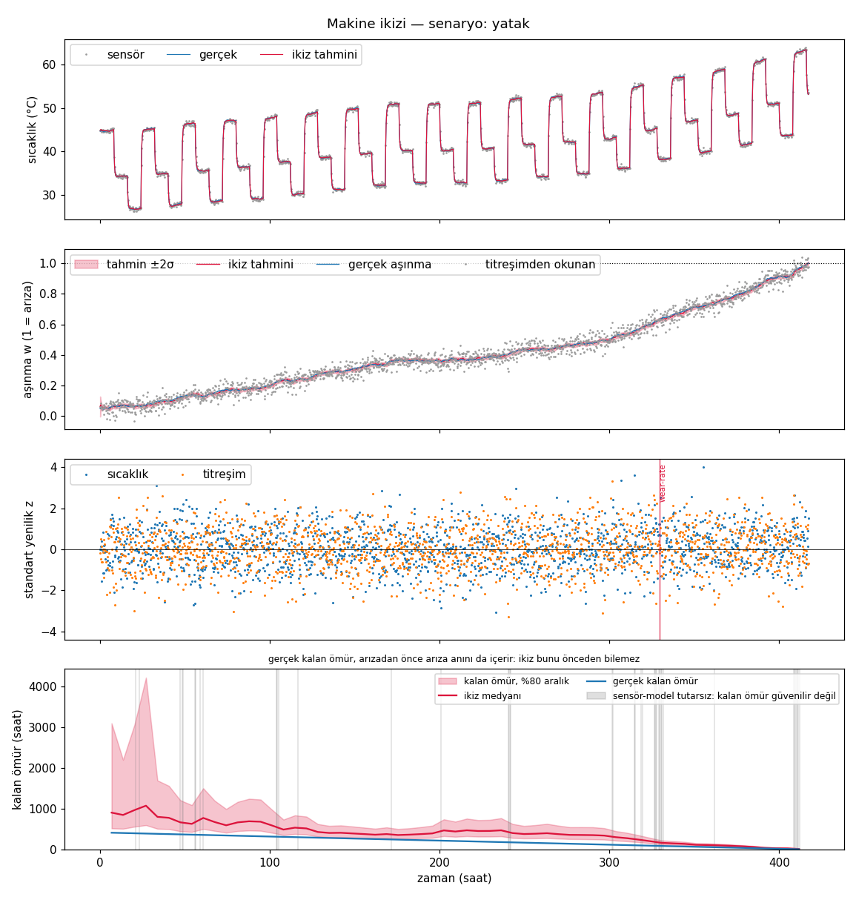
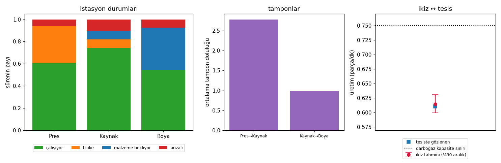

# smart-factory-digital-twin

A digital twin of **one machine** and of **a production line**, fed by simulated sensor data and
written to be *checked*: every estimator and model is compared with an analytic result or an
independent method, and the checks ship with the program (`fabrika dogrulama`) and the test suite.
It is the MVP of roadmap item #94 ("single machine / line digital twin, simulated sensor data").
CLI messages are in Turkish (`fabrika` subcommands are ASCII-transliterated Turkish, like the other
tools in this series); code and this document are in English.



| twin | what it does |
|---|---|
| **machine** | a plant simulator (thermal state, wear, vibration) produces temperature and vibration readings with noise, quantisation and lost samples; the twin filters them (Kalman), watches the innovations (CUSUM), estimates the wear rate and predicts the remaining useful life |
| **line** | a discrete-event simulator of a serial line (finite buffers, blocking, failures, scrap) plays the plant; the twin calibrates itself from the plant's event log with exact confidence intervals and predicts throughput exactly (Markov chain) or by simulation; what-if analysis |

You can also feed the machine twin **your own CSV** (`fabrika izle`) and describe **your own line**
in JSON (`fabrika hat --hat-dosyasi`). There is no real factory data in this repository: the plant
is simulated, see *Scope and limitations*.

## What is real and what is assumed

| | status |
|---|---|
| the methods (Kalman filter, CUSUM, first-passage remaining life, discrete-event simulation, continuous-time Markov chain, Garwood intervals) | standard, implemented from their definitions (references below) |
| the machine: thermal resistance and capacity, losses, wear and vibration coefficients, sensor noise | **assumed**, illustrative; not any particular machine |
| the plant *is the twin's own model plus noise* | **assumed**: the temperature/wear dynamics and the twin's filter share one structure, so the twin is well specified. A real machine would not be; the cooling-fault example shows what a mismatch does |
| line parameters (service times, MTBF, MTTR, buffers) | invented for the demos; your own go in a JSON file |

## Models

1. **Plant** ([`machine.py`](src/fabrika_ikizi/machine.py)). `c dT/dt = P - (T - T_amb)/R` with
   `P = p0 + p1 u^2 + p2 w` (idle loss, load loss, friction heat growing with wear `w`); the step is
   the exact exponential solution. Wear: `dw = kappa g(u) dt + sigma dW`, failure when `w` reaches 1.
   Vibration `v = v0 + kv w`. Faults: `bearing` (wear rate x`m`) and `cooling` (thermal resistance x`m`).
2. **Sensors** ([`sensors.py`](src/fabrika_ikizi/sensors.py)). Noise, bias, quantisation, random and
   burst dropouts, a stuck sensor, a drifting sensor.
3. **Twin** ([`twin.py`](src/fabrika_ikizi/twin.py), [`kalman.py`](src/fabrika_ikizi/kalman.py)). A linear
   Kalman filter over `(T, w, kappa)`, `kappa` being a wear-rate multiplier that drifts as a random
   walk; missing samples are skipped. Standardised innovations feed two-sided CUSUM charts
   ([`monitor.py`](src/fabrika_ikizi/monitor.py)); a `kappa` estimate above 1.8 raises the wear-rate alarm.
4. **Remaining life** ([`rul.py`](src/fabrika_ikizi/rul.py)). The time for a Wiener process with drift to
   reach the wear limit is inverse Gaussian; the twin samples it with the posterior uncertainty of
   `(w, kappa)` propagated.
5. **Line** ([`line.py`](src/fabrika_ikizi/line.py)). Event-driven simulation: blocking after service,
   zero-size buffers hand parts over directly, calendar-time failures with preemptive resume, scrap,
   saturated or Poisson source, exponential/deterministic/Erlang/lognormal service. Reports state
   shares, buffers, WIP, cycle time, Little's-law residual and OEE.
6. **Exact line solver** ([`ctmc.py`](src/fabrika_ikizi/ctmc.py)). For exponential services and finite
   buffers the stationary distribution of the state chain, from a linear solve.
7. **Calibration and prediction** ([`calibrate.py`](src/fabrika_ikizi/calibrate.py),
   [`linetwin.py`](src/fabrika_ikizi/linetwin.py)). Rates from the plant's log with exact intervals,
   service-time family fitted from the log's variability, predictive interval by sampling the rates,
   speed-up ranking and buffer studies.

## What is checked, and against what

`fabrika dogrulama` repeats the checks below (about 65 s; their details are printed in English); the
tests repeat them with fixed seeds.

- **Kalman filter.** Its final estimate and covariance equal the weighted least-squares solution over
  the whole window, set up as one information-form problem and solved from the normal equations
  (differences 7e-13 and 5e-13, with 20 % of the samples lost). On data drawn from the model itself the
  normalised estimation error squared averages 3.25 against the state dimension 3 (standard error
  0.23), 91 % inside the 95 % chi-square bound; a scalar random walk reaches the closed-form
  steady-state variance exactly.
- **Innovations.** On the plant (a different generator than the model's) the standardised innovations
  have mean 0.006 and -0.006, standard deviation 0.996 and 1.004 and lag-1 correlation -0.012 and
  0.006; the mean NIS is 2.00 for two channels. That is what makes the chart theory below applicable.
- **Control charts.** CUSUM run lengths by simulation against the Brook-Evans Markov chain and
  Siegmund's approximation: in control 336.7 ± 6.2 against 335.4 and 338.1 (k = 0.5, h = 4), shifted
  by one sigma 8.3 against 8.4. The two-sided in-control ARL comes out 168 for h = 4 and 465 for h = 5,
  the widely tabulated values. Shewhart `|z| > 3`: false-alarm rate 0.00269 against the exact 0.00270.
- **Remaining life.** The inverse-Gaussian law against 9 000 simulated wear paths (exact
  Brownian-bridge crossing probability inside each step): mean Kolmogorov distance 0.021 against a
  bound of 0.031, mean 791 against 792 h, variance ratio 0.998; the sampler passes the same test.
- **Remaining-life intervals.** On 60 machines with different wear severity, judged at 150 h, the 80 %
  interval contains the true remaining life **90 %** of the time with the estimation uncertainty
  propagated and only **53 %** for the plain plug-in distribution.
- **Detection and false alarms.** Cooling x1.3: median delay 0.25 h. Bearing x3: 6/6 detected, median
  32 h after onset, with 123 h of life left. On healthy machines the first-alarm rate is 0.0042 per
  sample (99 % interval 0.0023-0.0070) against the design value 0.0040.
- **Line solver.** Two reliable exponential stations against the birth-death closed form (difference
  3e-16); identical stations without a buffer give exactly 2/3; M/M/1/5 loss probability and mean
  number; a single unreliable machine runs at rate x availability.
- **Event simulation against the exact solution** (10 replications each): two reliable stations
  0.7228 ± 0.0011 against 0.7214, two stations with failures 0.6150 ± 0.0024 against 0.6153, three
  stations 0.6304 ± 0.0022 against 0.6306, a Poisson source with a waiting room 0.6178 ± 0.0016
  against 0.6173; mean WIP agrees to better than 1 %.
- **M/G/1.** The Pollaczek-Khinchine mean wait for exponential, deterministic, Erlang-2 and lognormal
  service (3.95 ± 0.06 against 4.00, 2.03 against 2.00, 3.02 against 3.00, 3.85 ± 0.05 against 4.00);
  Little's law holds to better than 1 % in every run.
- **Calibration.** The exact 95 % rate intervals contain the true rate in 96.5 % of 400 exponential
  samples and 93.3 % of 240 service/MTBF/MTTR intervals from 40 simulated event logs.
- **Line twin against exact truth.** For 30 plant logs of 6 000 minutes the twin's 90 % throughput
  interval contains the *exact* throughput of the true line in 25 of 30 (83 %; a calibrated interval
  would do worse than that one time in six).
- **What-if.** A 10 % speed-up gains most at the station with the smallest capacity, the throughput
  rises with buffer size and stays below the capacity bound.

## Example

```
$ fabrika makine --senaryo yatak --saat 800 --tohum 3
Makine ikizi: senaryo yatak, 1670 örnek, 417 saat, tohum 3
  sıcaklık tahmin hatası (rms): 0,106 °C; aşınma tahmin hatası (rms): 0,0059; gerçek aşınma ±2σ içinde: %96,3
  yenilik tutarlılığı (NIS ort., beklenen ≈ ölçülen kanal sayısı): 1,94
  makine 417,2. saatte arızalandı (aşınma 1'e ulaştı)
  alarmlar (1): wear-rate@329,5h
  yanlış alarm: 0; arıza tespit gecikmesi: 29,5 saat (wear-rate)
  kalan ömür (376. saatte): medyan 80 saat, %80 aralık [61; 110]; gerçek 42

$ fabrika hat --hat montaj --tohum 2
Hat ikizi: Pres (1,00 dk exp, MTBF 120/MTTR 8) → Kaynak (1,20 dk exp, MTBF 90/MTTR 10) → Boya (0,90 dk exp, MTBF 200/MTTR 15); tamponlar: 4 → 4
  tesis (20000 dk simülasyon): üretim 0,6108 parça/dk, ort. WIP 6,30, çevrim süresi 10,31 dk (Little artığı 0,03%), fire 0
  ikiz (kayıttan kalibre, exact): üretim 0,6148 parça/dk, %90 aralık [0,5992; 0,6309]  → tesisteki değer aralığın içinde
  gerçek parametrelerle kesin çözüm (Markov zinciri, 384 durum): 0,6184 parça/dk
  darboğaz (kapasite): Kaynak; tesiste en yüklü istasyon: Kaynak; kapasite üst sınırı 0,7500 parça/dk

$ fabrika ne-olur --hat montaj --tampon-arasi 1 --tampon-boyutlari 0,1,2,4,8,16
    Kaynak       +0,0338 parça/dk (+%5,46)      <- a 10 % faster welding station
    Pres         +0,0120 parça/dk (+%1,94)
    Boya         +0,0062 parça/dk (+%1,01)
  Kaynak → Boya tamponu büyüklüğüne göre üretim:   0 yer: 0,5115 ... 16 yer: 0,6509 parça/dk
```



The bearing run: the wear estimate follows the true wear, the wear-rate alarm fires 29.5 h after the
fault, and the remaining-life band closes in on the true value, which before the fault includes a
failure no model could foresee.

## Things found along the way

- **A persistent fault buried the operator in alarms.** The textbook CUSUM resets after an alarm, so a
  drifting sensor produced 540 alarms in 600 h. The streaming chart now latches: one alarm on the
  rising edge, re-armed once the statistic falls below `h/2`; the first-alarm time is unchanged, so the
  run-length theory still applies.
- **The remaining-life number is only as good as the model.** With a cooling fault (`--senaryo sogutma`,
  thermal resistance x1.3) the twin has no thermal-resistance state, so it explains the extra heat as
  wear: the wear estimate is off by 0.23 (rms; 0.006 on a healthy machine), the NIS is 71 instead of 2,
  and the "remaining life" collapses (18 h in the run shown in `examples/sogutma.png`) although the machine is fine. The temperature chart
  alarms within 0.25 h, and the twin marks the remaining life as unreliable while a chart is high
  (grey band in the plot, a warning in the text).
- **Responsiveness has a price, measured both ways.** Right after an abrupt x3 bearing fault the
  wear-rate estimate lags. `fabrika rul-sinama` measures it on 40 machines: with the default
  `q_kappa = 0.03` the 80 % remaining-life interval contains the truth in 2 % of the machines 50 h after
  the fault (median estimate 1.66 x the true life) and 44 % after 100 h (1.30 x); with `q_kappa = 0.08`
  78 % and 90 % (1.21 x, 1.02 x). The price shows on healthy machines: the wear-rate estimate deviates
  from 1 by 0.24 (rms) with 0.03 and 0.37 with 0.08, and the per-machine maximum averages 1.37 (largest
  1.63) against 1.80 (largest 2.03) with the alarm level at 1.8, so the faster twin raises false
  wear-rate alarms. The default favours few false alarms; `--q-kappa` is the dial.
- **Plug-in intervals are too narrow.** Using the best estimate as if it were exact gives an interval
  that holds the true remaining life 53 % of the time instead of 80 %; sampling the posterior of
  `(w, kappa)` fixes it (90 %, mildly conservative).
- **Assuming exponential service biased the line twin by 8 %.** On the four-station `gercekci` line (Erlang,
  lognormal and deterministic services, scrap) the twin calibrated with every service time exponential
  predicted 0.608 parts per minute against 0.6635 observed (-8.3 %). Fitting the family from the log's
  variability (Erlang-4, Erlang-4, Erlang-3, deterministic) and the scrap fraction gives 0.6626
  (-0.1 %). `calibrated_line(result, line, fit_dist=False)` reproduces the first number.
- **My own tests failed for the wrong reasons.** A test that demanded zero false alarms from a
  detector designed to have one per 10 000 samples fails by construction on 43 % of the seeds; those
  tests now use a design run length of a million samples. A single Kolmogorov-Smirnov test also fails one
  time in twenty, so the first-passage check pools six batches against a bound derived from the
  statistic's own mean and spread. An M/G/1 check with a heavy-tailed lognormal (cv 1.5) was 3.2
  standard errors off in one run and 2 above in another with more replications: noise of a highly
  autocorrelated estimator, not bias, so it now uses cv 1 and wider bounds.
- **The exact solver does not scale.** The three-station example has 384 states and solves in 0.02 s;
  the dense solve is impractical beyond a few thousand states, so larger lines and non-exponential
  services fall back to replicated simulation (which is also what the `gercekci` line uses).

## Usage

```bash
python3 -m venv .venv
source .venv/bin/activate
pip install -e ".[dev]"

fabrika senaryolar
fabrika makine --senaryo yatak --saat 800 --grafik yatak.png      # also: saglikli, sogutma, sensor-takili, sensor-kayma, veri-kaybi
fabrika simule --senaryo sensor-kayma --saat 600 --cikti akis.csv
fabrika izle --veri akis.csv --grafik izle.png                    # your own CSV works too
fabrika hat --hat montaj --grafik hat.png                         # or gercekci, or --hat-dosyasi hat.json
fabrika ne-olur --hat montaj --tampon-arasi 1 --tampon-boyutlari 0,1,2,4,8,16
fabrika hat-yaz --hat montaj --cikti hat.json                     # a starting point for your own line
fabrika rul-sinama --q-kappa 0.08 --sonra 100
fabrika dogrulama
```

Your own sensor data: a CSV with the columns `zaman_saat, yuk, sicaklik_C, titresim_mm_s` (time in
hours at a regular step, load fraction 0-1 from the PLC, temperature, vibration RMS; empty cells are
lost samples; a semicolon-delimited file with decimal commas is read as well). The twin's machine
constants are those of `MachineParams`; `--parametre dosya.json` overrides any of them, and
`--sigma-sicaklik/--sigma-titresim` set the sensor noise. For a real machine they must be calibrated
first: the twin is only as good as its model. Line files list stations (`ad, sure, dagilim, mtbf,
mttr, fire`), `tamponlar` (null = unlimited), and optionally `varis_hizi` and `bekleme_kapasitesi`.

## Testing

```bash
pytest -v
```

156 tests in about two minutes, no mocking (tests that break the filter or a closed form confirm that
a check can fail). Pure numerical Python (numpy, matplotlib), no network, no model calls.

## Scope and limitations

- The plant is a simulator that shares the twin's model structure; no real factory data was used.
  A real machine needs its constants identified, and its faults will not look like the two injected here.
- One machine with two sensors (temperature, vibration) and a known load; a linear model of wear and
  heat. No multi-fault diagnosis: a chart alarm says *that* the sensors disagree with the model and on
  which channel, not why (a drifting temperature sensor raises alarms on the temperature *and* the vibration channel).
- Remaining life assumes the planned load profile continues (the three-shift day) and a Wiener wear
  process; after an abrupt fault it lags (see above).
- The line is serial with blocking after service; no rework loops, assembly/disassembly, batch
  processing, shifts or setups. Failures are calendar-time and exponential; the exact solver needs
  exponential services, finite buffers and no scrap.
- The calibration assumes the structure (stations, buffers) is known and only the rates are estimated.

## References

R. E. Kalman (1960); the batch/information form is standard (e.g. Bar-Shalom, Li and Kirubarajan,
*Estimation with Applications to Tracking and Navigation*). E. S. Page (1954) and D. Siegmund (1985)
for CUSUM; H. D. Brook and D. A. Evans, Biometrika 59 (1972) for the run-length chain; D. Montgomery,
*Introduction to Statistical Quality Control*, for the tabulated ARLs. J. R. Michael, W. R. Schucany and
R. W. Haas, American Statistician 30 (1976) for sampling the inverse Gaussian. M. Garwood (1936) for the
exact Poisson interval. J. Buzacott and G. Shanthikumar, *Stochastic Models of Manufacturing Systems*,
and M. Gershwin, *Manufacturing Systems Engineering*, for serial lines with finite buffers.
J. Pollaczek and A. Khinchine for the M/G/1 mean wait.

## License

MIT -- see [LICENSE](LICENSE).
